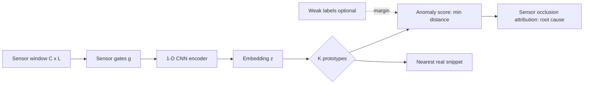
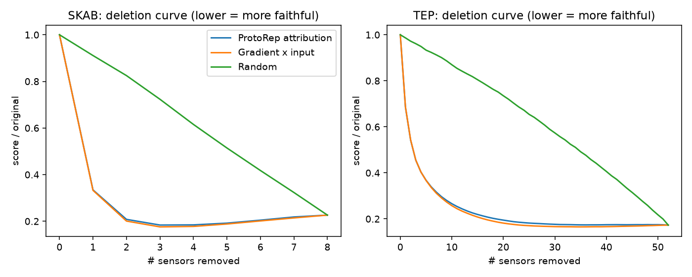
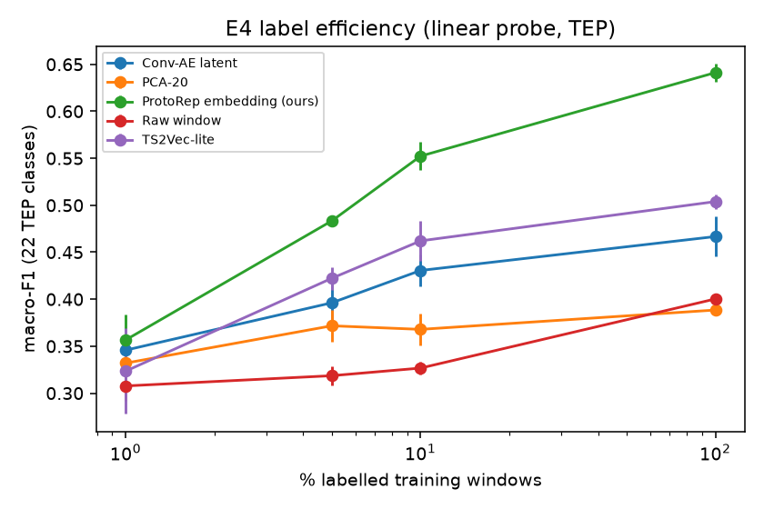
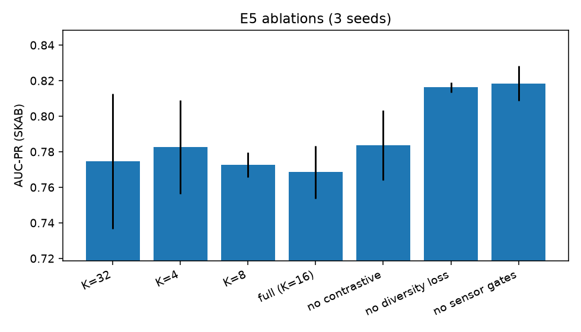

# ProtoRep — Explainable prototype representations for industrial multivariate time series

Author: **Hossein Tabasi** · License: MIT

ProtoRep learns a **structured, explainable representation** of multivariate sensor windows: every window is described by its similarity to a small set of learned **prototypes**, and each prototype is then *pushed* onto a real training snippet. Learned **sensor gates** show which sensors the representation uses. The anomaly score is the distance to the nearest prototype, so every alarm comes with (a) the closest real normal snippet and (b) a per-sensor attribution for root-cause analysis.

## Method

The input is a window $x\in\mathbb{R}^{C\times L}$. It is passed through sensor gates $g=\sigma(\gamma)\in(0,1)^C$, then through a 1-D CNN encoder $f$, giving $z=f(g\odot x)\in\mathbb{R}^d$.

Prototypes $p_1..p_K$ live in latent space, and the window's similarity to each one is

$$s_k=\log\frac{\|z-p_k\|^2+1}{\|z-p_k\|^2+\epsilon}$$

The anomaly score is $a(x)=\min_k\|z-p_k\|^2$.

The training loss is

$$\mathcal{L}=\underbrace{\mathcal{L}_{\text{InfoNCE}}(z,z')}_{\text{augment views}}+\lambda_c\,\overline{\min_k\|z-p_k\|^2}+\lambda_e\,\overline{\min_i\|z_i-p_k\|^2}+\lambda_d\sum_{k\ne l}\max(0,\tau-\|p_k-p_l\|)^2+\lambda_s\|g\|_1\;[+\lambda_w\,\text{margin}(a,y_{weak})]$$

**Push:** after training, each prototype is replaced by its nearest training embedding, so it corresponds to a real snippet.

**Attribution:** sensor $c$'s attribution is $\Delta a$ when that sensor is replaced by its reference mean. This needs only forward passes.



## Data (real, public)

| Dataset | Source | Use |
|---|---|---|
| SKAB (Skoltech Anomaly Benchmark), 8 sensors | https://github.com/waico/SKAB | E1, E2, E4b, E5 |
| Tennessee Eastman Process (Braatz), 52 vars, 21 faults | https://github.com/camaramm/tennessee-eastman-profBraatz | E1, E2, E3, E4 |

Run `bash scripts/download_data.sh` to fetch the data. A tiny sample is included in `data/sample/`. Raw data is not committed.

## Quickstart

```bash
pip install -r requirements.txt && pip install -e .
bash scripts/download_data.sh
pytest -q                      # 10 tests
bash scripts/run_all.sh        # CPU only; ~30-40 min total with 2 threads
```

All hyperparameters are in `configs/default.yaml`: `n_prototypes`, `window`, `epochs`, `sensor_sparsity`, `seeds`.

## Results (3 seeds, mean ± std; full tables in `reports/RESULTS.md`)

### E1 — Anomaly detection vs strong baselines (AUC-PR)

| Method | SKAB | TEP |
|---|---|---|
| ProtoRep (ours) | 0.769 ± 0.015 | 0.984 ± 0.000 |
| TS2Vec-lite + 1-NN | **0.825 ± 0.008** | 0.974 ± 0.001 |
| LSTM autoencoder | 0.814 ± 0.006 | 0.983 ± 0.001 |
| Conv autoencoder | 0.800 ± 0.009 | **0.985 ± 0.000** |
| Isolation Forest | 0.784 ± 0.010 | 0.970 ± 0.002 |
| PCA reconstruction | 0.702 | 0.980 |

ProtoRep is **not** the best detector on SKAB. On TEP it is on par with the best (Conv-AE). Its value is in the explanations and the representation (E2–E4), not raw detection. Base rates are high (SKAB test is about 54% anomalous; TEP is about 83%).

### E2 — Is the explanation faithful? (deletion AUC ↓ / insertion AUC ↑)

| Attribution | SKAB del ↓ | SKAB ins ↑ | TEP del ↓ | TEP ins ↑ |
|---|---|---|---|---|
| ProtoRep occlusion (forward only) | 0.306 | 0.920 | 0.242 | 0.991 |
| Gradient × input | 0.302 | 0.924 | 0.234 | 0.994 |
| Random | 0.617 | 0.604 | 0.622 | 0.626 |

The attributions are far better than random and match gradient-based attribution without needing backprop. 

### E3 — Do prototypes align with TEP fault types? (22 classes)

| Method | NMI | ARI |
|---|---|---|
| ProtoRep nearest prototype (K=22) | 0.462 | **0.140** |
| k-means on PCA-20 | **0.530** | 0.084 |
| k-means on Conv-AE latent | 0.458 | 0.070 |
| k-means on TS2Vec-lite | 0.406 | 0.071 |

The prototype assignment gives the best ARI, but PCA+k-means gives the best NMI. The result is mixed.

### E4 — Label efficiency (linear probe, TEP 22-class macro-F1)

| Representation | 1% | 5% | 10% | 100% |
|---|---|---|---|---|
| **ProtoRep** | **0.357** | **0.483** | **0.552** | **0.641** |
| TS2Vec-lite | 0.324 | 0.422 | 0.462 | 0.504 |
| Conv-AE | 0.346 | 0.396 | 0.431 | 0.467 |
| PCA-20 | 0.332 | 0.372 | 0.368 | 0.389 |
| Raw window | 0.308 | 0.319 | 0.327 | 0.400 |

This is the clearest win: with 10% of labels, ProtoRep beats every baseline even when those baselines use 100% of labels. 

### E4b — Weak supervision (SKAB valve1+valve2 test)

| Variant | AUC-PR |
|---|---|
| Unsupervised (normal references only) | **0.817 ± 0.021** |
| + weak labels (10% of 'other' runs) | 0.739 ± 0.037 |

**Negative result:** the weak-label margin term *hurt* performance in this setting. One likely reason is that the labelled anomalies in the 'other' runs come from different fault mechanisms than the test valves.

### E5 — Ablations (SKAB)

| Variant | AUC-PR | AUC-ROC | unique prototypes | gate entropy (bits, max 3) |
|---|---|---|---|---|
| K=32 | 0.775 ± 0.038 | 0.772 | 32 | 2.999 |
| K=4 | 0.783 ± 0.026 | 0.765 | 4 | 2.990 |
| K=8 | 0.773 ± 0.007 | 0.766 | 8 | 2.999 |
| full (K=16) | 0.768 ± 0.015 | 0.760 | 16 | 2.999 |
| no contrastive | 0.784 ± 0.020 | 0.753 | 15 | 2.967 |
| no diversity loss | 0.816 ± 0.003 | 0.803 | 16 | 2.997 |
| no sensor gates | 0.818 ± 0.010 | 0.804 | 16 | 3.000 |

**Honest finding:** removing the diversity loss or the sensor gates *improves* SKAB detection (to about 0.817, which matches the LSTM-AE). These components buy interpretability at a detection cost. Note: with sparsity 0.01 the sensor gates stay near-uniform (entropy ≈ 3 bits), so the gates add little sparsity at this setting. 

## Limitations
- The detection gain over autoencoders is not established; on SKAB, simpler encoders win.
- The weak-label hook did not help (E4b).
- The evaluation uses point-wise metrics on datasets with high anomaly base rates. Point-adjusted F1 is reported in RESULTS but is optimistic.
- CPU-only with short training (12 epochs). All results come from 3 seeds.

## Cite
```bibtex
@software{tabasi_protorep_2026,
  author = {Hossein Tabasi},
  title  = {ProtoRep: Explainable prototype representations for industrial multivariate time series},
  year   = {2026},
  url    = {https://github.com/hosseinTabasi/protorep-explainable-ts}
}
```
